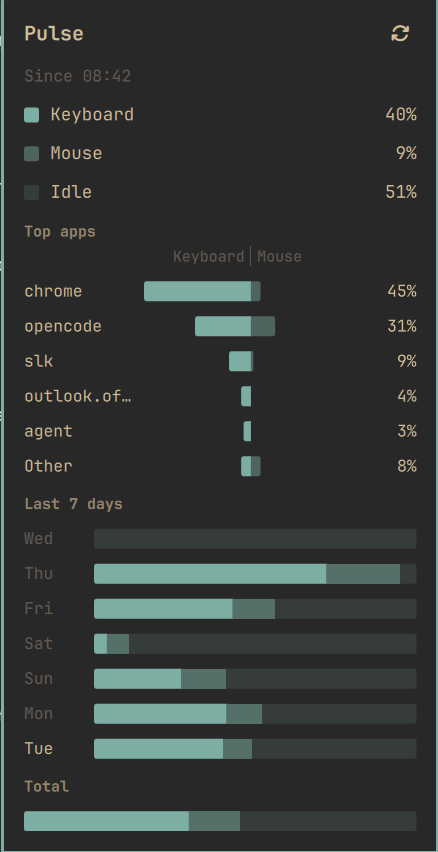
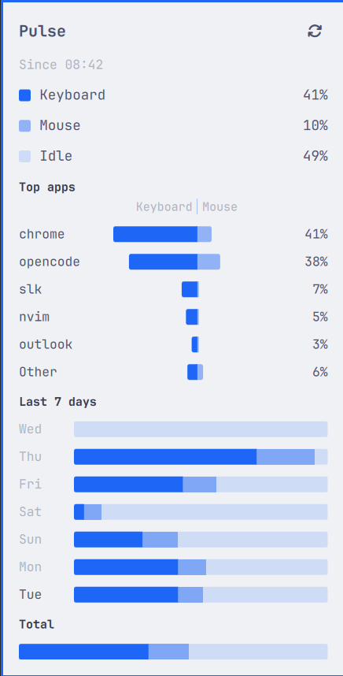
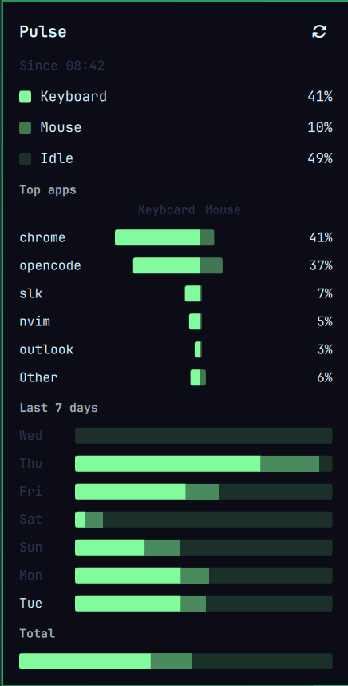

# omarchy-pulse

> How did your day split between keyboard, mouse, and thinking? A live, private answer — right in your Omarchy bar.


**Status: v0.1.0.** Used daily on Omarchy — see [docs/PLAN.md](docs/PLAN.md) and the [release](https://github.com/Maxsh/omarchy-pulse/releases/tag/v0.1.0).

## The idea

Activity trackers usually count things — keystrokes, clicks, minutes. Counts don't answer the question that matters when you look back at a day: *where did my time go?* omarchy-pulse measures **time**: for every second of your session it works out whether your hands were on the keyboard, on the mouse, or resting (reading, thinking, talking). The widget shows that split as percentages — no scores, no absolute counters, no key contents.

## What it shows

- **Bar widget** — a compact stacked mini-bar: today's keyboard / mouse / idle split. Hover for exact percentages, left click to open the panel, right click to force a refresh.
- **Panel**
  - **Today** — keyboard, mouse, and idle as percentages of your session so far (first input → now; away time over 3 minutes is excluded).
  - **Top apps** — where today's active time went, per app, each bar split by that app's own keyboard/mouse ratio (needs a window watcher, see Install).
  - **Last 7 days** — one stacked bar per day, hover for exact numbers.
  - **Total** — the weekly aggregate.
  - The title opens the ActivityWatch dashboard for deep dives.

Everything follows your Omarchy theme, and the panel speaks English and Ukrainian:

<p align="center">
  
  
  
</p>

## Why

Omarchy runs Hyprland on Wayland, and Wayland deliberately keeps apps from sniffing global input — so the stock ActivityWatch input watcher (pynput/X11) sees nothing there. omarchy-pulse fills the gap with two small pieces:

1. **`pulse-watcher`** — an evdev-based watcher (systemd user service) that attributes input time per minute — never key contents — and stores it in [ActivityWatch](https://activitywatch.net/), which already handles storage, retention, and a full web dashboard.
2. **`maxsh.pulse`** — an [Omarchy shell](https://omarchy.org/) plugin (Quickshell/QML) that reads ActivityWatch's local API and renders the bar widget and panel.

## How activity is measured

Raw counts alone can't answer "was I typing or mousing?" — one key press and one second of scrolling are both just "1". So the watcher goes one step further and reconstructs, per second, **which device your hands were on**, using results from HCI motor-behavior research (the same constants that power the [Keystroke-Level Model](https://web.eecs.umich.edu/~kieras/docs/GOMS/KLM.pdf), Card, Moran & Newell 1980):

- **Input comes in bursts.** A pause longer than ~2 s ends a typing burst (a word pause), ~1 s ends a pointing burst; the last 1 s of each burst still counts as that device's time.
- **Switching devices costs "homing" time** — the KLM's H operator, 0.4 s — credited to the device you switch *to*. A quick click after typing therefore charges the click (plus homing) to the mouse, not the keyboard.
- **Modifiers belong to mouse actions.** A key event within 0.3 s of a click, or while a button is held (Shift+drag, Ctrl+click), counts as mouse work.
- **Motion is real only above a threshold.** ≥ 1 mm of pointer travel within 250 ms (touchpad resolution from the kernel; mice assumed 1000 DPI). Hand tremor while reading stays idle.
- **Held keys and buttons count as continuous time.** Autorepeat keeps the keyboard alive; a held button keeps the mouse alive without needing movement.
- **Gaming-style overlap** — WASD plus aiming, alternating faster than homing — is recognized as *both* at once and split evenly for display.
- **Away time.** In the widget, input gaps longer than 3 minutes (ActivityWatch's AFK threshold) drop out of the day's span instead of reading as idle — lunch and sleep don't dilute the split.

Per minute, the watcher stores the stock counters (`presses`, `clicks`, …) plus `kbS` / `mouseS` / `bothS` — seconds per device class. Keyboard, mouse, and idle are then measured in the same unit and always add up to the span. Classification never sees *which* key was pressed — timing and counts only.

## Architecture

```
        ┌──────────────────────────┐
        │   /dev/input/event*      │
        └────────────┬─────────────┘
                     ▼
┌────────────────────────────────────────┐
│ pulse-watcher (Python + evdev)         │
│ systemd user service · counts only     │
└──────────────────┬─────────────────────┘
                   ▼  per-minute counts + seconds (REST · localhost:5600)
┌────────────────────────────────────────┐
│ ActivityWatch (aw-server-rust)         │
│ storage · REST API · web dashboard     │
│ window focus from aw-awatcher (opt.)   │
└──────────────────┬─────────────────────┘
                   ▼  HTTP/JSON, polled every 60 s and on panel open
┌────────────────────────────────────────┐
│ Omarchy shell widget (Quickshell/QML)  │
│ bar mini-bar · popup panel             │
└────────────────────────────────────────┘
```

Events go into the stock `aw-watcher-input_{hostname}` bucket with the stock keys (`presses`, `clicks`, `deltaX`, …) plus additive `kbS` / `mouseS` / `bothS`, so ActivityWatch's own views keep working.

## Requirements

- Omarchy (Hyprland + Omarchy shell)
- [ActivityWatch](https://activitywatch.net/) — `omarchy pkg aur add activitywatch-bin`
- [`uv`](https://docs.astral.sh/uv/) — manages the watcher's Python 3.11+ venv and `evdev`
- Your user in the `input` group — `sudo usermod -aG input $USER`, then log out and back in
- Optional, for Top apps: a window watcher writing a `currentwindow` bucket — `aw-awatcher` ships with activitywatch-bin and the install script sets it up

## Install

One step (also the update path — re-run after `git pull`):

```bash
git clone https://github.com/Maxsh/omarchy-pulse && cd omarchy-pulse
install/install.sh
```

The script builds the watcher's venv, installs the systemd user units (with `ExecStart` rewritten to this clone's path — it never touches an existing ActivityWatch setup), installs the bar widget, and warns about the `input` group. Then add **Pulse** (category *Stats*) to your bar if it isn't there yet:

```bash
omarchy bar move maxsh.pulse --section right
```

Manual steps and watcher details: [watcher/README.md](watcher/README.md).

### Settings

The widget reads its inline entry in `~/.config/omarchy/shell.json` (hot-reloads):

```json
{ "id": "maxsh.pulse", "awUrl": "http://localhost:5600", "pollSeconds": 60, "appLabels": { "com.slk.Tui": "slk" } }
```

- `awUrl` — ActivityWatch base URL. For privacy the widget only talks to loopback hosts (`localhost`, `127.x`, `[::1]`); anything else falls back to the default.
- `pollSeconds` — bar poll interval (minimum 5, default 60).
- `appLabels` — display-name overrides for Top apps, for classes whose automatic shortening isn't what you want. The raw class stays the identity; only the label changes. ActivityWatch itself has no rename feature (its categorization maps apps to categories, not names), so this lives in the widget.

## Privacy: counts, never content

- The watcher sees key *events*, never records *which* key — not in storage, logs, or debug output. A test asserts emitted events contain only count/seconds fields.
- Mouse activity is clicks, scroll steps, and pointer distance.
- Everything stays local: ActivityWatch on `localhost:5600` and its local database. The widget talks to nothing else, and never reads browser-tab data.
- Stop it any time: `systemctl --user stop pulse-watcher`.

## Roadmap

- [x] Phase 1 — watcher: evdev → ActivityWatch, systemd user service
- [x] Phase 2 — bar widget: keyboard/mouse/idle mini-bar
- [x] Phase 3 — panel: today, last 7 days, weekly total
- [x] Phase 4 — input-time attribution (HCI-based), Top apps, polish
- [x] Phase 5 — v0.1: one-step install, Ukrainian translation, screenshots, license, release
- [ ] Share on Omarchy community channels

Decisions and details: [docs/PLAN.md](docs/PLAN.md).

## Related

- [ActivityWatch](https://activitywatch.net/) — local time/data tracker used as the storage backend
- [aw-awatcher](https://github.com/2e3s/aw-awatcher) — Wayland-native window/AFK watcher (powers Top apps)
- Omarchy shell plugin docs — see `~/.agents/skills/omarchy/plugins.md` on an Omarchy machine with this skill installed

## License

[MIT](LICENSE).
